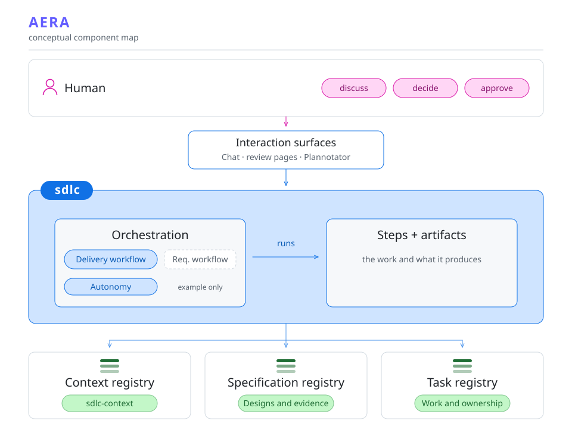

# Agentic SDLC

**From a ticket to an agreed solution, tested code, and a reviewed pull request.**

Agents do the research, planning, implementation, and code review. You shape the solution, approve the design and PR, and decide when to merge. Each step leaves files and decisions that the next step can use.

For Codex, Claude Code, and GitHub Copilot CLI / VS Code.

[Where this fits](#where-this-fits) · [Steps and outputs](#steps-and-outputs) · [Try it](#try-it)

## Where this fits

These plugins implement part of **AERA**, the **Agentic Engineering Reference Architecture for Software Delivery**. AERA brings human and agent work into an existing delivery process. Your workshops, refinement meetings, and architecture discussions remain part of that process.

<picture>
  <source media="(prefers-color-scheme: dark)" srcset="docs/assets/aera-layers-dark.svg">
  
</picture>

<table>
<thead><tr><th align="left" width="33%">Context registry</th><th align="left" width="34%">Specification registry</th><th align="left" width="33%">Task registry</th></tr></thead>
<tbody><tr valign="top">
<td>Shared project knowledge: rules, architecture, and domain terms.<p><code>sdlc-context</code> creates and connects registries and maintains their indexes and links.</p></td>
<td>Research, designs, decisions, and reviews for each feature.<p>Saved in the delivery folder. Reusable artifact definitions ship with <code>sdlc</code>.</p></td>
<td>Work items, ownership, and progress across the delivery process.</td>
</tr></tbody>
</table>

## Steps and outputs

**Agent** works independently. **Together** means discussion and decisions. **You approve** and **You instruct** mean the workflow waits for you.

<table>
<thead><tr><th align="left" scope="col" width="160">Stage</th><th align="left" scope="col" width="280">Step</th><th align="left" scope="col" width="120">Who</th><th align="left" scope="col" width="380">Files and results</th></tr></thead>
<tbody>
<tr valign="top">
<th rowspan="3" align="left" valign="top" scope="rowgroup">1. Understand<br><sub>00-02</sub></th>
<td>&nbsp; <strong>00</strong> <a href="plugins/sdlc/skills/00-create-workspace/SKILL.md">Set up the workspace</a></td><td>Agent</td>
<td><ul><li>Repository checkouts (cloned or reused)</li><li><a href="plugins/sdlc/artifact-definitions/00-manifest.state.md">Workspace manifest</a></li><li><a href="plugins/sdlc/artifact-definitions/AGENTS.md">Workspace instructions</a></li></ul></td></tr>
<tr valign="top">
<td>&nbsp; <strong>01</strong> <a href="plugins/sdlc/skills/01-research-current-solution/SKILL.md">Understand the current code</a></td><td>Agent</td>
<td><ul><li><a href="plugins/sdlc/artifact-definitions/01-current-solution.research.md">Solution design (current), with code references</a></li></ul></td></tr>
<tr valign="top">
<td>&nbsp; <strong>02</strong> <a href="plugins/sdlc/skills/02-analyze/SKILL.md">Find gaps and questions</a></td><td>Agent</td>
<td><ul><li><a href="plugins/sdlc/artifact-definitions/02-questions.inventory.md">Questions and open assumptions</a></li><li><a href="plugins/sdlc/artifact-definitions/02-work-breakdown.md">Proposed work breakdown</a></li></ul></td></tr>
</tbody>
<tbody>
<tr valign="top">
<th rowspan="2" align="left" valign="top" scope="rowgroup">2. Agree<br><sub>03-04</sub></th>
<td>&nbsp; <strong>03</strong> <a href="plugins/sdlc/skills/03-align/SKILL.md">Agree on the solution</a></td><td>Together</td>
<td><ul><li><a href="plugins/sdlc/artifact-definitions/03-agreement.spec.md">Agreed requirements</a></li><li><a href="plugins/sdlc/artifact-definitions/03-target-solution.spec.md">Solution design (target)</a></li><li><a href="plugins/sdlc/artifact-definitions/03-test-scenarios.spec.md">Test scenarios</a></li><li>Decision record and approval pages</li></ul></td></tr>
<tr valign="top">
<td>&nbsp; <strong>04</strong> <a href="plugins/sdlc/skills/04-approve-target-solution/SKILL.md">Approve the design</a></td><td>You approve</td>
<td><ul><li>Approval tied to the reviewed design and scenarios</li></ul></td></tr>
</tbody>
<tbody>
<tr valign="top">
<th rowspan="5" align="left" valign="top" scope="rowgroup">3. Build and review<br><sub>05-09</sub></th>
<td>&nbsp; <strong>05</strong> <a href="plugins/sdlc/skills/05-plan/SKILL.md">Plan the work</a></td><td>Agent</td>
<td><ul><li><a href="plugins/sdlc/artifact-definitions/05-implementation.plan.md">Implementation plan and work packages</a></li></ul></td></tr>
<tr valign="top">
<td>&nbsp; <strong>06</strong> <a href="plugins/sdlc/skills/06-implement/SKILL.md">Build and test</a></td><td>Agent</td>
<td><ul><li>Code, tests, and local commits</li><li><a href="plugins/sdlc/artifact-definitions/06-decisions.log.md">Implementation decisions</a></li></ul></td></tr>
<tr valign="top">
<td>&nbsp; <strong>07</strong> <a href="plugins/sdlc/skills/07-review/SKILL.md">Check the implementation</a></td><td>Agent</td>
<td><ul><li><a href="plugins/sdlc/artifact-definitions/07-review.state.schema.json">Review record with checked findings</a></li><li>Published pull request after review closes</li></ul></td></tr>
<tr valign="top">
<td>&nbsp; <strong>08</strong> <a href="plugins/sdlc/skills/08-review-pr/SKILL.md">Review the pull request</a></td><td>You approve</td>
<td><ul><li>PR review page with checks and findings</li><li>Approval tied to the reviewed commit</li></ul></td></tr>
<tr valign="top">
<td>&nbsp; <strong>09</strong> <a href="plugins/sdlc/skills/09-merge/SKILL.md">Merge on your instruction</a></td><td>You instruct</td>
<td><ul><li>Merged pull request and recorded merge commit</li></ul></td></tr>
</tbody>
<tbody>
<tr valign="top">
<th rowspan="1" align="left" valign="top" scope="rowgroup">4. Close and learn<br><sub>10</sub></th>
<td>&nbsp; <strong>10</strong> <a href="plugins/sdlc/skills/10-post-mortem/SKILL.md">Close and learn</a></td><td>Together</td>
<td><ul><li><a href="plugins/sdlc/artifact-definitions/10-post-mortem.md">Delivery summary and lessons</a></li><li>Settled assumptions and completed delivery record</li></ul></td></tr>
</tbody>
</table>

**Steps 06-09 repeat for each work package.** PR approval and the instruction to merge are separate decisions.

Links open the current skills and artifact definitions. Each delivery creates its own filled-in files. The workflow can resume from those files in a new session.

## Recommended review tool

**Recommended: [Plannotator](https://plannotator.ai).** Install it separately to comment on questions and design documents, and to review the actual PR diff. Chat and the PR platform's diff view are also supported.


## Try it

You need Git, Python 3, and one supported runtime. Choose your installation:

<details open>
<summary>GitHub Copilot CLI</summary>

```bash
copilot plugin marketplace add https://github.com/we-make-specs/sdlc.git
copilot plugin install sdlc@agentic-sdlc-marketplace
copilot plugin install sdlc-context@agentic-sdlc-marketplace
```

</details>

<details>
<summary>Codex</summary>

```bash
codex plugin marketplace add we-make-specs/sdlc
codex plugin add sdlc@we-make-specs
codex plugin add sdlc-context@we-make-specs
```

</details>

<details>
<summary>Claude Code</summary>

Run these commands inside a session:

```text
/plugin marketplace add https://github.com/we-make-specs/sdlc.git
/plugin install sdlc@agentic-sdlc-marketplace
/plugin install sdlc-context@agentic-sdlc-marketplace
```

</details>

Start a fresh session in your project or ticket folder. Run `/sdlc-context:connect` and provide your registry's URL or local path. If the project has no registry, use `/sdlc-context:connect none`.

Publishing and merging also need authenticated access to your repositories and pull requests through the runtime's tools or a CLI such as `gh`.

Give the workflow a ticket ID, a ticket URL, or a short description:

```text
/sdlc:run Add a CSV export for the currently filtered orders.
```

It starts with workspace setup and pauses for your input at the human steps. Later, run `/sdlc:run` from the same delivery to resume from the recorded state. You can also invoke an individual step when you need to revisit it.

<details>
<summary>Where are the files? How do updates work?</summary>

A delivery started in a ticket folder stores its artifacts in `delivery/` and its component clones in `repositories/`. Starting in a code repository supports `docs/sdlc/features/`. Existing deliveries keep their recorded layout.

Plugins are cached. Update or reinstall them, then start a new session. In Copilot CLI, `copilot skill list` should include `sdlc:run` and `sdlc-context:connect`.

</details>

## Go deeper

- [Workflow and step order](plugins/sdlc/workflow.yml)
- [Artifact definitions and workspace layout](plugins/sdlc/artifact-definitions/README.md)
- [How implementation review works](plugins/sdlc/skills/07-review/SKILL.md)
- [Context registry format](plugins/sdlc-context/reference.md)
- [Marketplace setup](MARKETPLACE.md)
